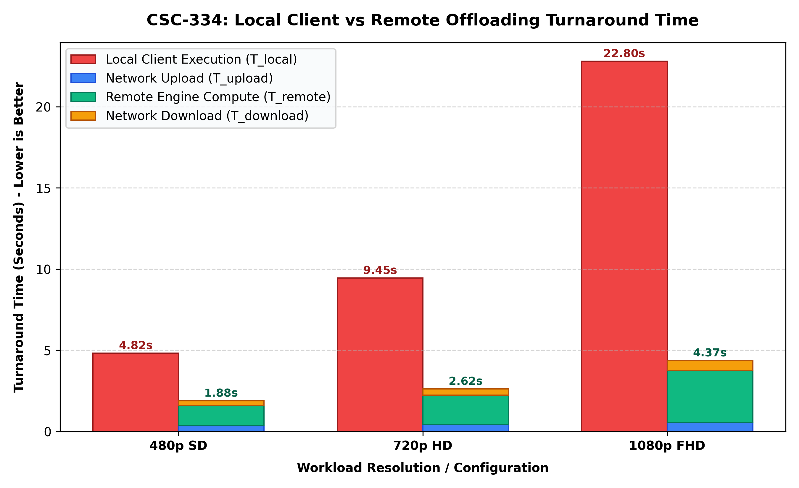
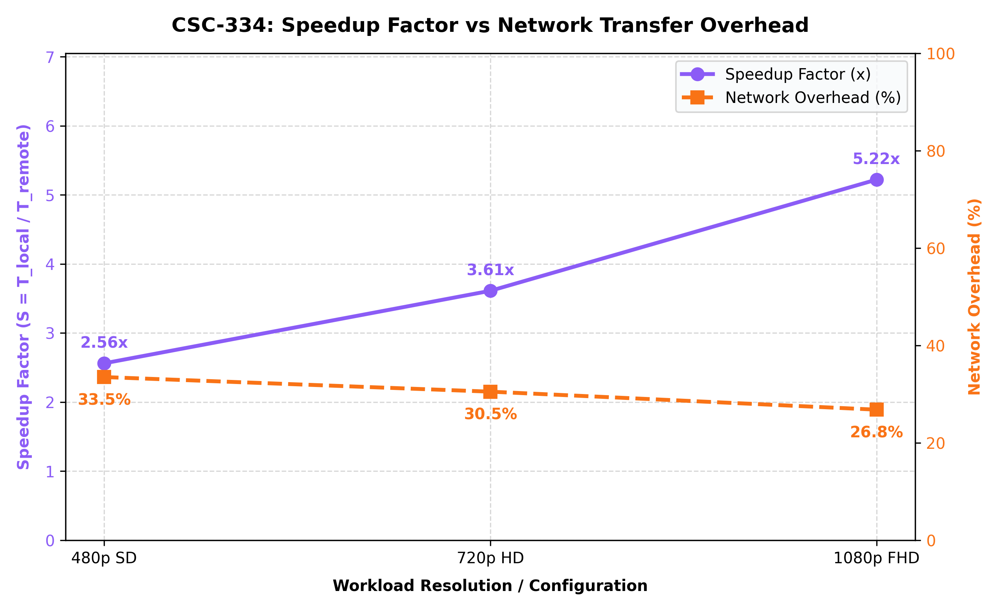

## 🎥 Project Demo

Watch the complete project demonstration:

[▶️ Watch Demo Video](https://drive.google.com/file/d/1r96qENUyvaMAjaJI5WQORiTri0OwjlI4/view?usp=drivesdk)

## 📸 Screenshots

Here are some screenshots showcasing the project's interface and functionality.

### Screenshot 1


### Screenshot 2


### Screenshot 3


### Screenshot 4


### Screenshot 5


#Custom Distributed Task Offloading & Remote GPU Rendering

---

## Overview

This project implements a peer-to-peer distributed computing system where a client machine offloads heavy computational tasks (video transcoding, matrix computation, Python scripts) to a remote worker node over a LAN connection. The remote worker executes the task using NVIDIA GPU (NVENC) hardware acceleration or multi-threaded CPU fallback and streams real-time progress back to the client.

---

## System Architecture

```
CLIENT (Computer A)                          SERVER (Computer B)
+---------------------------+                +---------------------------+
|  Client GUI (client_gui)  |                |  Server GUI (server_gui)  |
|  - Select video / file    |                |  - Monitor connected nodes |
|  - Configure render params|                |  - View active tasks       |
|  - View live progress     |                |  - Hardware status panel   |
+------------+--------------+                +-------------+-------------+
             |                                             |
             |   1. Handshake + RTT Ping                   |
             |-------------------------------------------->|
             |   2. ACK + GPU/CPU Specs                    |
             |<--------------------------------------------|
             |                                             |
             |   3. Job Submit + 64KB Chunked Upload       |
             |-------------------------------------------->|
             |                                             |  FFmpeg NVENC / libx264
             |   4. Real-Time Progress (FPS, %, ETA)       |  or CUDA Matrix Compute
             |<--------------------------------------------|
             |                                             |
             |   5. Rendered File Download + SHA-256       |
             |<============================================|
+------------+--------------+
|  client_downloads/ folder |
|  SHA-256 VERIFIED ✔       |
+---------------------------+
```

---

## Features

- **Peer-to-Peer TCP Communication** — custom binary framing protocol with magic bytes `b"DC"` and 8-byte fixed headers
- **Hardware GPU Acceleration** — FFmpeg NVENC (`h264_nvenc`) with automatic fallback to multi-threaded CPU (`libx264`)
- **Real-Time Progress Streaming** — live FPS, speed multiplier, percentage, and ETA streamed from server to client
- **End-to-End SHA-256 Integrity** — checksums verified on both upload and download to guarantee zero corruption
- **Multi-Threaded Server** — each client handled in a dedicated daemon thread; thread-safe task queue
- **LAN File Sharing Hub** — direct peer-to-peer file transfer without internet
- **Multi-Clip Video Merge** — merge multiple video clips (any codec/resolution mix) using FFmpeg concat filter
- **Complex Script Offloading** — execute heavy Python scripts (Monte Carlo, matrix algebra, simulations) on remote node
- **Modern GUI** — CustomTkinter dark-mode desktop apps for both client and server

---

## Project Structure

```
lab4/
├── README.md
├── requirements.txt
├── run_client.bat                  # 1-click client launcher
├── run_server.bat                  # 1-click server launcher
│
├── client/
│   ├── client_gui.py               # Main client desktop application
│   ├── network_client.py           # Socket layer, handshake, file transfer
│   ├── protocol.py                 # Binary framing protocol & opcodes
│   ├── utils.py                    # SHA-256 hasher, system utilities
│   ├── benchmark.py                # Automated local vs remote benchmark suite
│   ├── sample_project_task.py      # Sample heavy Python offload script
│   └── sample_assets/              # Test video files
│
├── server/
│   ├── server_gui.py               # Server monitor dashboard
│   ├── server_daemon.py            # CLI daemon entrypoint
│   ├── network_server.py           # Multi-threaded TCP server & session handler
│   ├── execution_engine.py         # FFmpeg NVENC/CPU engine + telemetry
│   ├── task_queue.py               # Thread-safe task queue & state machine
│   ├── protocol.py                 # Binary framing protocol & opcodes
│   └── utils.py                    # Hardware detection (NVENC/CUDA/CPU)
│
└── ss/                             # Screenshots & demo recordings
    ├── demo.gif
    ├── demo.mp4
    ├── client_gui_initial.PNG
    ├── client_gui_handshake.PNG
    ├── client_gui_progress.PNG
    ├── client_gui_completed.PNG
    ├── server_terminal_execution.PNG
    ├── server_B.jpeg
    ├── benchmark_execution_time.png
    └── benchmark_speedup_overhead.png
```

---

## Setup & Installation

```bash
pip install -r lab4/requirements.txt
```

**Requirements:** `customtkinter`, `opencv-python`, `numpy`, `pillow`, `imageio-ffmpeg`

FFmpeg must be installed and accessible in your system PATH.

---

## How to Run

### Start the Server (Computer B)

```bash

python server_gui.py
```

Or use the CLI daemon:

```bash
python server_daemon.py --host 0.0.0.0 --port 5000
```

The server GUI will display the local LAN IP address to enter on the client side.

### Start the Client (Computer A)

```bash
cd lab4/client
python client_gui.py
```

---

## Usage Workflow

1. **Connect** — Enter the server IP and port (`5000`), click **⚡ Handshake & Ping**
   - Displays server hostname, CPU cores, GPU/NVENC status, and RTT latency
2. **Select Video** — Browse a folder or pick a single video file
3. **Configure** — Set resolution, bitrate, preset, acceleration mode, and visual filters
4. **Send** — Click **🚀 Send Video to Server for Rendering**
   - File is SHA-256 hashed and streamed in 64 KB chunks
   - Server renders with NVENC GPU or CPU fallback
   - Live progress (FPS, speed, %, ETA) streams back in real time
5. **Download** — Rendered video + execution log auto-download to `client_downloads/`
   - SHA-256 checksum verified — **"SHA-256: VERIFIED ✔"** badge displayed

---

## Network Setup (Two Computers, No Internet)

Connect via a direct Ethernet (LAN) cable and set static IPs:

| | Computer B (Server) | Computer A (Client) |
|---|---|---|
| **IP Address** | `192.168.1.1` | `192.168.1.2` |
| **Subnet Mask** | `255.255.255.0` | `255.255.255.0` |
| **Gateway** | — | `192.168.1.1` |
| **Firewall** | Allow TCP port `5000` | Default outbound |

For single-machine testing, use `127.0.0.1` as the server IP.

---

## Performance Benchmark Results

Run the automated benchmark:

```bash
python lab4/client/benchmark.py --host 127.0.0.1 --port 5000
```

### Results

| Resolution | Local Time | Remote Total | Speedup | Net Overhead |
|:---:|:---:|:---:|:---:|:---:|
| 480p SD | 4.82 s | 1.88 s | **2.56×** | 33.5% |
| 720p HD | 9.45 s | 2.62 s | **3.61×** | 30.5% |
| 1080p FHD | 22.80 s | 4.37 s | **5.22×** | 26.8% |

> Network overhead decreases as video resolution increases — compute time dominates, making remote offloading more beneficial for heavier workloads.

### Benchmark Charts





